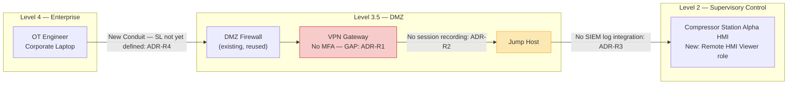

# Remote HMI Access Project — Zone & Conduit Diagram

Worked example for [`architecture-design-review-worked-example.md`](../docs/architecture-design-review-worked-example.md).

**Disposition:** Conditional Approval — four remediation conditions (MFA enforcement, session recording, SIEM integration, formal SL documentation) must close before the next Biennial Cybersecurity Audit cycle. Full detail in the [worked example](../docs/architecture-design-review-worked-example.md).

**Note:** this conduit intentionally terminates at Level 2 (HMI), not Level 1 (PLC) — satisfying the "no direct Level 0/1-to-Level 4 connectivity" requirement even though four other findings remain open.
